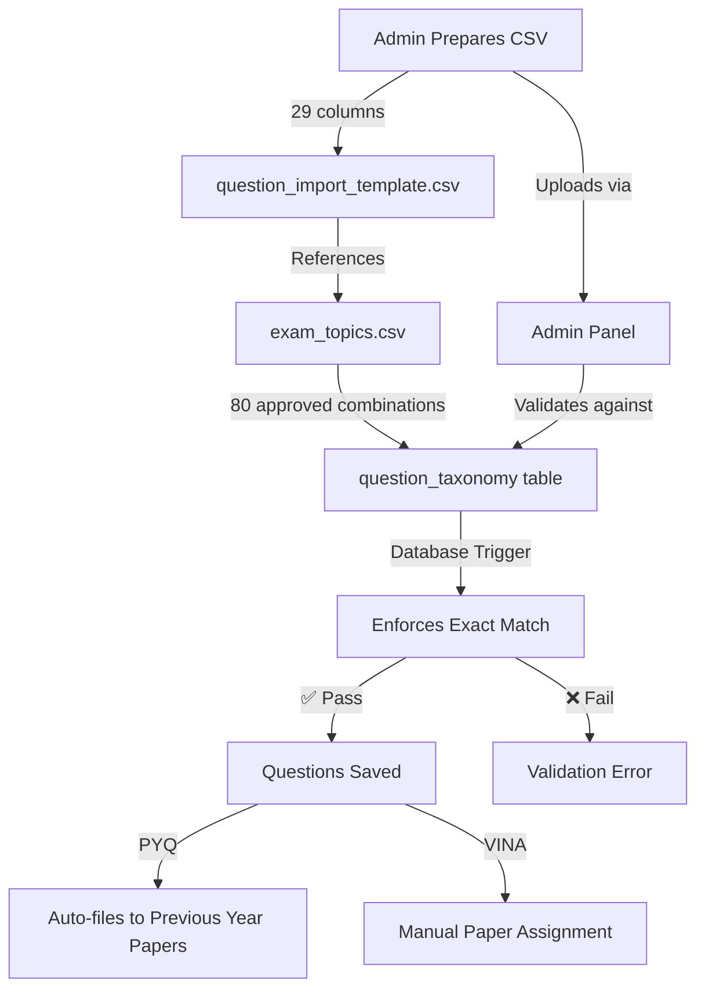

# 📚 TNPSC MOCK TEST - CSV IMPORT SYSTEM

## Complete Documentation Index

---

## 🎯 Quick Navigation

### For Admin Users (Question Upload)
1. **[CSV_UPLOAD_CHEATSHEET.md](./CSV_UPLOAD_CHEATSHEET.md)** ⭐ START HERE
   - One-page quick reference
   - 29-column format summary
   - Common errors & fixes

2. **[ADMIN_CSV_IMPORT_GUIDE.md](./ADMIN_CSV_IMPORT_GUIDE.md)**
   - Complete step-by-step guide
   - Detailed validation rules
   - Upload workflow

3. **[SINGLE_CSV_FORMAT.md](./SINGLE_CSV_FORMAT.md)**
   - Visual column structure
   - PYQ vs VINA comparison
   - Quick import workflow

### For Reference (Taxonomy Catalog)
4. **[exam_topics.csv](./exam_topics.csv)** ⭐ TAXONOMY SOURCE
   - 80 approved combinations
   - Copy-paste from here (don't type manually)
   - Used for validation

5. **[APPROVED_TAXONOMY_REFERENCE.md](./APPROVED_TAXONOMY_REFERENCE.md)**
   - Human-readable taxonomy guide
   - Organized by exam group
   - Browse-friendly format

### For Developers
6. **[CSV_IMPORT_FORMAT.md](./CSV_IMPORT_FORMAT.md)**
   - Technical column specifications
   - Database schema mapping
   - Validation logic

7. **[TNPSC_Micro_Macro_Topics_Master_With_Weightage.csv](./TNPSC_Micro_Macro_Topics_Master_With_Weightage.csv)**
   - 91-row master taxonomy with weightages
   - Future: Micro-topic level quotas for 200Q mock tests
   - Currently: Reference only

### Templates
8. **[question_import_template.csv](./question_import_template.csv)** ⭐ USE THIS
   - 5 sample questions (4 PYQ + 1 VINA)
   - Pre-filled with correct format
   - Copy and modify for your questions

---

## 🔄 The Complete System



---

## 📋 The Single CSV Format

### ONE Format for All Imports
```
File: question_import_template.csv
Columns: 29 (exact order required)
Validation: Against exam_topics.csv (80 rows)
Upload: Admin Panel → Extracted Questions → Bulk Upload CSV
```

### Column Groups
| Group | Columns | Purpose |
|-------|---------|---------|
| **Auto-Generated** | 1-2 | question_id, content_hash (leave empty) |
| **Metadata** | 3-14 | exam_tag, source_type, year, taxonomy, difficulty |
| **English Content** | 15-20 | Question + 4 options (option E fixed) |
| **Tamil Content** | 21-26 | Question + 4 options (option E fixed) |
| **Answer & Explanation** | 27-29 | answer_key, en_explanation, ta_explanation |

---

## 🎯 Key Concepts

### 1. Taxonomy Validation (CRITICAL)
```
Your CSV columns 7, 8, 9:
unit_code + macro_topic + micro_topic

MUST match exactly one row in:
exam_topics.csv (80 approved combinations)

Otherwise:
❌ Rejected by database trigger
```

### 2. PYQ vs VINA
| Type | Year | Auto-file | Use Case |
|------|------|-----------|----------|
| **PYQ** | Required (2000-2026) | ✅ YES (by exam_tag + year) | Official past papers |
| **VINA** | Optional (typically 2026) | ❌ NO (manual assignment) | Practice questions |

### 3. Exam Groups
| Exam Tag | Structure | Total Questions |
|----------|-----------|-----------------|
| `TNPSC_GROUP_1` | 175 GS + 25 Aptitude | 200 |
| `TNPSC_GROUP_2` | 75 GS + 25 Aptitude + 100 Language | 200 |
| `TNPSC_GROUP_4` | 75 GS + 25 Aptitude + 100 Tamil | 200 |

### 4. Deduplication
```
✅ Each question has content_hash (SHA-256)
✅ PYQ questions cannot duplicate each other
✅ VINA questions cannot match PYQ content_hash
✅ System prevents duplicate questions automatically
```

---

## 🚀 Quick Start Guide

### For First-Time Users

**Step 1**: Download the template
```bash
question_import_template.csv
```

**Step 2**: Open reference file
```bash
exam_topics.csv
```

**Step 3**: Prepare your CSV
1. Keep columns 1, 2, 20, 26 empty
2. Fill column 3 (exam_tag): `TNPSC_GROUP_4`
3. Fill column 4 (source_type): `PYQ` or `VINA`
4. Fill column 5 (year): `2024` for PYQ, `2026` or empty for VINA
5. **Copy-paste** columns 7, 8, 9 from `exam_topics.csv` (don't type!)
6. Fill columns 15-19 (English question + options)
7. Fill columns 21-25 (Tamil question + options)
8. Fill column 27 (answer_key): `A`, `B`, `C`, or `D`
9. Fill columns 28-29 (explanations)

**Step 4**: Upload
```
Admin Panel → Extracted Questions → Bulk Upload CSV
```

**Step 5**: Review & Confirm
```
✅ Fix any validation errors
✅ Confirm import
```

---

## ⚠️ Common Mistakes

### ❌ Mistake 1: Typing Taxonomy Manually
```csv
# WRONG:
unit_code: Unit 1 - General Science
macro_topic: Physics
micro_topic: Mechanics

# CORRECT:
unit_code: Unit 1: General Science
macro_topic: Physics
micro_topic: Mechanics & Properties of Matter
```
**FIX**: Always copy-paste from exam_topics.csv

---

### ❌ Mistake 2: Missing Year for PYQ
```csv
# WRONG:
source_type: PYQ
year: 

# CORRECT:
source_type: PYQ
year: 2024
```
**FIX**: PYQ always needs year (2000-2026)

---

### ❌ Mistake 3: Wrong exam_tag Format
```csv
# WRONG:
TNPSC GROUP 4
Group4
TNPSC-GROUP-4

# CORRECT:
TNPSC_GROUP_4
```
**FIX**: Use underscore, exact format

---

## 📊 System Architecture

### File Hierarchy
```
📁 UPSC-MOCK/
├── 📄 question_import_template.csv ⭐ UPLOAD THIS
├── 📄 exam_topics.csv ⭐ REFERENCE THIS
├── 📄 TNPSC_Micro_Macro_Topics_Master_With_Weightage.csv
├── 📄 CSV_UPLOAD_CHEATSHEET.md ⭐ READ THIS FIRST
├── 📄 ADMIN_CSV_IMPORT_GUIDE.md
├── 📄 SINGLE_CSV_FORMAT.md
├── 📄 APPROVED_TAXONOMY_REFERENCE.md
├── 📄 CSV_IMPORT_FORMAT.md
└── 📄 README_CSV_SYSTEM.md (this file)
```

### Database Tables
```
question_taxonomy (80 rows)
├── Stores approved taxonomy combinations
├── Loaded from exam_topics.csv
└── Enforced by database trigger

questions
├── Stores all questions (PYQ + VINA)
├── Validated against question_taxonomy
└── Auto-generates question_id and content_hash

papers
├── Stores mock test papers
├── PYQ auto-files by exam_tag + year
└── VINA requires manual assignment
```

---

## 🔒 Validation Layers

### Layer 1: CSV Parser
```
✅ Checks 29 columns present
✅ Parses CSV with quoted values
✅ Handles UTF-8 encoding (English + Tamil)
```

### Layer 2: Client-Side Validation
```
✅ Validates exam_tag format
✅ Validates source_type (PYQ/VINA)
✅ Checks PYQ year (2000-2026)
✅ Maps to approved catalog
✅ Deduplication check (VINA vs PYQ)
```

### Layer 3: Database Trigger (CRITICAL)
```
✅ Enforces taxonomy match against question_taxonomy table
✅ Cannot be bypassed
✅ Rejects ANY question with unapproved taxonomy
```

---

## 📈 Benefits of This System

### ✅ Zero Mismatch
- Every question maps to exact syllabus topic
- No orphan questions
- Clean analytics

### ✅ 200Q Mock Test Generation
- Quota-based fetching by unit/topic
- Exact syllabus compliance
- Zero-repetition tracking

### ✅ Interactive Syllabus
- Real-time mastery tracking
- Topic-level practice drills
- Progress visualization

### ✅ Master Analytics
- Unit & Topic accuracy
- Pacing analysis (54s/Q benchmark)
- Mistake log & weak topics

---

## 📞 Support & Troubleshooting

### Quick Checklist
- [ ] Using question_import_template.csv as base?
- [ ] Taxonomy copied from exam_topics.csv (not typed)?
- [ ] PYQ has year 2000-2026?
- [ ] exam_tag format: TNPSC_GROUP_X?
- [ ] source_type is PYQ or VINA?
- [ ] difficulty_level is EASY/MEDIUM/HARD?
- [ ] answer_key is A/B/C/D?
- [ ] Both English and Tamil text provided?
- [ ] Saved as UTF-8 CSV?

### Still Getting Errors?
1. Download fresh question_import_template.csv
2. Copy one working sample row
3. Modify only question/answer content
4. Keep taxonomy identical
5. Test with single row first

---

## 🎓 Training Resources

### For New Admins
1. Read: CSV_UPLOAD_CHEATSHEET.md (5 minutes)
2. Download: question_import_template.csv
3. Open: exam_topics.csv for reference
4. Practice: Upload 1-2 sample questions
5. Review: Validation feedback
6. Scale: Upload full question bank

### For Developers
1. Read: CSV_IMPORT_FORMAT.md
2. Review: AdminExtractedQuestionsPage.jsx
3. Understand: Database trigger in 00013_pdf_taxonomy_lock.sql
4. Test: Validation logic locally

---

## 📅 Version History

### Current System
- **29-column CSV format** ✅
- **80-row taxonomy** (exam_topics.csv) ✅
- **Database trigger validation** ✅
- **PYQ auto-filing** ✅
- **Deduplication gate** ✅

### Future Enhancements (Spec Document)
- **91-row master taxonomy** with weightages 🔄
- **Micro-topic level quotas** for 200Q tests 🔄
- **Granular question distribution** 🔄

---

## 🎯 Summary

**ONE CSV FORMAT**: 29 columns (question_import_template.csv)  
**ONE TAXONOMY SOURCE**: 80 rows (exam_topics.csv)  
**ONE UPLOAD METHOD**: Admin Panel → Bulk Upload CSV  
**ONE VALIDATION RULE**: Taxonomy MUST match catalog exactly

**This ensures:**
- ✅ Zero taxonomy mismatches
- ✅ Clean mock test generation
- ✅ Accurate analytics
- ✅ Reliable syllabus tracking

**No exceptions. No workarounds. One system, perfectly synchronized.**

---

## 📄 Document Quick Links

| Document | Purpose | Audience |
|----------|---------|----------|
| [CSV_UPLOAD_CHEATSHEET.md](./CSV_UPLOAD_CHEATSHEET.md) | Quick reference (1 page) | Admins ⭐ |
| [ADMIN_CSV_IMPORT_GUIDE.md](./ADMIN_CSV_IMPORT_GUIDE.md) | Complete guide | Admins |
| [SINGLE_CSV_FORMAT.md](./SINGLE_CSV_FORMAT.md) | Visual format guide | Admins |
| [exam_topics.csv](./exam_topics.csv) | Taxonomy catalog | Reference ⭐ |
| [APPROVED_TAXONOMY_REFERENCE.md](./APPROVED_TAXONOMY_REFERENCE.md) | Human-readable taxonomy | Reference |
| [CSV_IMPORT_FORMAT.md](./CSV_IMPORT_FORMAT.md) | Technical specs | Developers |
| [question_import_template.csv](./question_import_template.csv) | Template with samples | Use This ⭐ |

---

**Last Updated**: 2024  
**Maintained By**: TNPSC Mock Test Development Team
